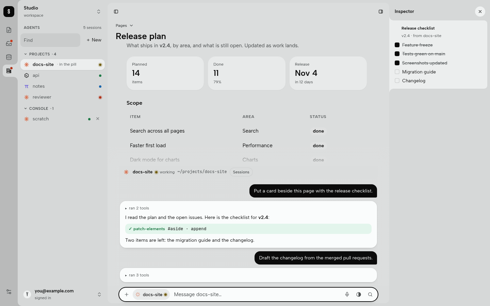

# herdr console (`artyficial.herdr`)

An RT Station Plugin that lets you drive your [herdr](https://github.com/ogulcancelik/herdr)
sessions (coding agents in a terminal multiplexer) from the **pill** of an RT Station
Workspace. Pick a running session or start a new one, talk to it, and watch its reply stream
in above the pill. When the agent writes a **patch block**, the console applies it to the page
you are looking at. An **Agents** panel in the sidebar lists every session with its live
status.



What you can do:

- open the **Agents** panel in the sidebar: every session grouped by herdr workspace with its
  live status, the one in the pill marked, and a badge when a session is blocked or done;
- tap the session chip in the pill (or type `@`) to pick a running session, with its agent,
  folder and status (idle, working, blocked, done);
- start a new Claude, Pi, Codex or other agent in a folder you choose;
- talk to it: the reply streams into a wide thread above the pill;
- let it change the page: each patch block shows a chip, green when applied, red with the
  reason when refused.

It is a Broker Tier Plugin that asks for **Caller Tickets** (`"subjects": {"caller": true}`):
it patches only the browser session that called it, through `core.ui.caller.patch`, under the
page's Accept Rules. It needs the herdr socket on the same machine
(`"permissions": {"host_access": ["herdr-socket"]}`), so it is offered for local devices only.

## Terms

- **RT Station**: the server (the `rt` binary) that runs a Workspace.
- **Workspace**: one app on RT Station: a folder with `.env`, its state folder (`.rt/`, or
  `.ds/` in rt v0.20.1) and its pages.
- **Plugin**: a program a Workspace runs beside itself to add capabilities. A **Broker Tier**
  Plugin is a long-running process that talks to the server over its message broker.
- **Shell**: the HTML frame every page of a Workspace sits in (header, sidebar, the pill).
- **The pill**: the shell's input bar at the foot of the page, where you talk to an agent.
- **Stage** and **Patch Region**: the Stage (`stage.json`) names the parts of the shell that
  code may fill; each such part is a Patch Region. A **personal** Patch Region is filled for
  one browser session only.
- **Accept Rules**: the checks a Patch Region applies to any HTML put into it.
- **Caller Ticket**: a short-lived permission that lets a Plugin patch the one browser
  session that called it, and no other.
- **Workspace catalog**: the server's list of what a Workspace serves (capabilities, Patch
  Regions); `rt describe` prints it.
- **Artyficial Space**: the marketplace that lists Plugins, shells and themes for RT Station
  from GitHub releases, such as the ones in this repository.
- **Device Control**: the RT Station program on your own machine that installs what you pick
  in the Space into your Workspaces.

## What you need

- **herdr** running on the same machine as the Workspace, as the same user.
- **Linux on amd64** for the release asset. Other platforms, macOS included, need a build from
  source, and that is not possible until the RT Station Go SDK is public (see below).
- **An RT Station Workspace whose shell has the pill slot for this Plugin**, and an `rt` with
  Caller patches (`core.ui.caller.patch`, Caller Tickets). The public release **v0.20.1** has
  them. The shell must carry:
  - the pill `<div id="pill" data-agent="artyficial.herdr.console" data-agent-version="1.0.0">`
    and the element `#pill-console`, which is the personal Patch Region `console`;
  - for the Agents panel, the element `#agents-panel`, the personal Patch Region `agents`.

  Which shells have it:
  - **rt v0.20.1**: the base shell that `rt init` writes has the pill, `#pill-console` and
    `#agents-panel`, and its `stage.json` declares the Patch Regions `console` and `agents`.
    Nothing else to do.
  - **Newer rt (the `.rt/` Workspace layout)**: a plain `rt init` shell does not have them.
    Create the Workspace with `rt init --shell ribbon-deck`: that shell carries the pill,
    `#pill-console`, `#agents-panel` and the Patch Regions `console` and `agents`.

  Only a shell that ships the pill script works: `plugins/pill.js` in the rt v0.20.1 base shell,
  and `web/plugins/pill.js` in the ribbon-deck shell. That script makes the console's
  controls work (`data-pill-call`, `data-pill-form`, the Find filter, the follow and agents
  calls), and the shell's styles draw the `.hc-*` and `.ha-*` classes. Adding the two
  elements to another shell is not enough. To use another shell, copy the pill, its script
  and its styles from the ribbon-deck shell's `web/index.html` and `web/plugins/`; then
  `bin/herdr-console regions` adds the two Patch Regions to `stage.json`.

  Without the Patch Region, `{"action":"open"}` answers "the Workspace catalog declares no
  Patch Region console".

## Install from the Artyficial marketplace

The Artyficial Space lists this Plugin from the release tag `artyficial.herdr--v1.1.0`.
Install it from the Space on the device that runs your Workspace: Device Control downloads the
release asset, checks its SHA-256 and its manifest, and installs it.

After that install the Plugin is installed but not enabled, and enabling it needs the package
folder staged in the Workspace. So go on with steps 1 to 3 of the next section: they stage
the same release folder, review it, and enable it.

## Install the release asset by hand

1. Download `artyficial.herdr-1.1.0-linux-amd64.tar.gz` from the GitHub Release
   `artyficial.herdr--v1.1.0` of this repository.
2. Extract it into a new, empty folder. It holds `manifest.json`, the `provider` binary and
   `THIRD_PARTY_NOTICES`:

   ```sh
   mkdir herdr-console && tar -xzf artyficial.herdr-1.1.0-linux-amd64.tar.gz -C herdr-console
   ```

3. As the signed-in owner (`rt login`) of the running Workspace, from the Workspace folder,
   stage, review, install, configure and enable it. This needs `jq`:

   ```sh
   ver() { rt capability list | jq -r --arg id "$1" '[.. | objects | select(.id? == $id) | .version] | first'; }
   inv() { rt capability invoke "$1" "$(ver "$1")" "$2"; }
   staging="$(inv core.plugin.list '{}' | jq -r .result.package_staging)"
   mkdir -p "$staging" && rm -rf "$staging/herdr-console" && cp -R /path/to/herdr-console "$staging/herdr-console"
   inv core.plugin.review '{"package":"herdr-console"}'       # read it before you go on
   digest="$(inv core.plugin.review '{"package":"herdr-console"}' | jq -r .result.digest)"
   inv core.plugin.install   '{"package":"herdr-console","digest":"'"$digest"'","allow_unsigned":true}'
   inv core.plugin.configure '{"id":"artyficial.herdr","digest":"'"$digest"'","configuration":{}}'
   inv core.plugin.enable    '{"package":"herdr-console","digest":"'"$digest"'","allow_unsigned":true}'
   inv core.plugin.logs '{"id":"artyficial.herdr"}' | jq -r .result.text   # "ready: herdr …, socket …"
   ```

   The review says: tier broker, "Caller: it may patch the browser session that calls it", and
   "Host access: it talks to these local resources: herdr-socket". `allow_unsigned` is needed
   because the package is not signed; you accept it on your own authority. `ver` reads the
   served version of each `core.plugin.*` capability, which differs between rt releases.

If you have a clone of this repository, `bin/herdr-console` does all of step 3 for you, and also
adds the Patch Regions to `stage.json`:

```sh
bin/herdr-console install -w /path/to/workspace -p /path/to/herdr-console
```

### Upgrade, configure, remove

- **Upgrade**: `core.plugin.disable {"id":"artyficial.herdr"}`, then stage, review, install and
  enable the new folder. The configuration is kept. `bin/herdr-console install` does this when
  the Plugin is already installed.
- **Configure**: `core.plugin.disable`, `core.plugin.configure` with the installed digest and
  the new configuration, then `core.plugin.enable`.
- **Remove**: `core.plugin.disable`, then `core.plugin.remove {"id":"artyficial.herdr","retain_data":true}`
  (core always keeps the data). `bin/herdr-console remove --purge` also deletes the Plugin's
  data, packages, locks and staged copy from the Workspace's `.rt/` (or `.ds/`) folder.

`bin/herdr-console` works with both Workspace layouts: `.rt/` (current rt) and `.ds/`
(rt v0.20.1). Its other commands: `status` (version, state, digest) and `regions` (only add the
Patch Regions). Options: `-w DIR` (the Workspace, default the current folder), `-a URL` (the
server, default `http://localhost:$PORT` from the Workspace's `.env`), `--rt BIN`. Restart
`rt run` after `stage.json` changes.

## Build from source

**Building needs the RT Station Go SDK, which is not public yet.** The module imports
`github.com/ndendic/data-start`, and `go.mod` replaces it with `../../../data-start`: a
data-start checkout beside this repository. Without that checkout you cannot build; use the
release asset instead. With one somewhere else, set `DATA_START_DIR`:

```sh
go run build.go                                   # package/: the provider binary and manifest.json
DATA_START_DIR=~/src/data-start go run build.go   # the same, with a copy of go.mod that points there
go test ./...                                     # unit tests: parser, safety rules, rendering, stdio frames, manifest
bin/herdr-console install -w /path/to/workspace   # build, then install as above
```

`build.go` builds for the target `go env GOOS GOARCH` reports and writes it to
`manifest.platform.targets`. To make a release asset:

```sh
bin/release                              # linux/amd64
GOOS=darwin GOARCH=arm64 bin/release     # another target
```

It writes `dist/artyficial.herdr-<version>-<os>-<arch>.tar.gz` with `rt package pack` and prints
its SHA-256 and size. That needs an `rt` built from current RT Station source that has
`rt package pack`; no public release has it yet. Check with `rt package help`. The archive
holds `manifest.json`, the `provider` binary and `THIRD_PARTY_NOTICES` (the licences of the
code linked into the binary).
The Space takes the first `.tar.gz` asset of a release, so one release carries one target.

## Configuration

One JSON object; unknown keys are refused. Every key is optional. Change it only while the
Plugin is disabled.

| Key | Default | Meaning |
|---|---|---|
| `herdr_bin` | `"herdr"`, then `~/.local/bin/herdr` | the herdr binary |
| `herdr_socket` | `~/.config/herdr/herdr.sock` | the herdr server's API socket (`HERDR_SOCKET_PATH`) |
| `crew` | `[]` | session names (herdr name or terminal title, any case) that always need the two-step confirm, even when the console opened them; the console also refuses to start a session under one of these names. The picker and the panel mark them "crew". |
| `console_workspace` | `"Console"` | the herdr workspace label for sessions the console opens |

For example: `{"crew": ["reviewer", "docs-site"]}`.

The Plugin's environment carries no `HOME`; it finds the home directory from the account
database.

## The capability

`artyficial.herdr.console` 1.0.0, input `{action, …}`. The pill posts one action per call;
every call brings a fresh Caller Ticket, and the Plugin answers by patching that browser
session. Without a ticket (not a signed-in browser) it answers `{"ok": false, "message": …}`
and does nothing.

| Action | Input | What happens |
|---|---|---|
| `open` | `filter?` | the session picker, in the Patch Region `console`: a search row on top ("Find a session or folder"; the shell filters rows by name or folder, the same filter as "@text" in the pill), the rows in a list that scrolls, "New session…" fixed at its foot |
| `select` | `pane` | follows that session: `$pillAgent`, the thread, live status |
| `send` | `pane, text, confirm?` | sends a message (see Safety) |
| `keys` | `pane, keys, confirm?` | keys a person chose on the dialog card; only to a blocked session |
| `new` | | the new-session form |
| `start` | `kind, other_kind?, cwd, name?` | a new tab in `console_workspace` (no focus), then `herdr agent start` |
| `close` | `pane` | closes a session the console opened |
| `teach` | `pane` | sends the patch-block primer once to a session the console opened |
| `follow` | `pane?`, `fresh?`, `resync?` | renews the ticket, keeps streaming, sends `$pillAgent` again; `fresh` (a page that just loaded) forgets the shown view, so the next call renders it whole; `resync` (a tab shown again: its Stream was closed while hidden) renders the thread whole and sends `$pillAgent` again from the follower, which retries until the page listens |
| `dismiss` | | cancels a confirm, or empties the console |
| `agents` | `filter?` | renders the Agents panel whole into the Patch Region `agents` and sends `$herdrBadge`; keeps both live while the panel is open (see below). `filter` (≤ 128) is only the Find field's text, put back as its value |

`follow` also sends `$herdrBadge` when it changed and restarts the panel's live loop while the
panel is open (`fresh`: the next push renders the panel whole; `resync`: it sends the list again).

The signal `pillAgent` is `{pane, name, kind, status, crew, folder}` or `null`. The signal
`herdrBadge` is `"blocked"` (any session blocked), else `"done"` (any done), else `null`. Markup
uses the `.hc-*` classes the shell styles; every control carries `data-pill-call` (JSON) or
`data-pill-form`; there is no script and no `on*` attribute.

## The Agents panel

`agents` patches `#agents-panel` (region `agents`, mode `inner`):

```html
<div class="ha-panel">
  <div class="ha-tools">
    <input class="ha-find" data-ha-find type="search" placeholder="Find" aria-label="Find a session or folder" value="">
    <button type="button" class="ha-new" data-pill-call='{"action":"new"}'>＋ New</button>
  </div>
  <div id="ha-list" data-sessions="3">            <!-- the live part -->
    <p class="ha-error" role="alert">…</p>        <!-- only when herdr could not be read -->
    <details class="ha-group" id="ha-g-…" data-ws="w1" open>
      <summary class="ha-group-h"><span>Projects</span><span class="ha-count">2</span></summary>
      <div class="ha-row" role="button" tabindex="0" aria-current="true" data-pane="w1:p2"
           data-search="docs-site ~/src/docs-site" title="~/src/docs-site" data-pill-call='{"action":"select","pane":"w1:p2"}'>
        <span class="ha-ico" data-kind="claude">…svg…</span><span class="ha-name">docs-site</span>
        <span class="ha-crew">crew</span><span class="ha-here">· in the pill</span>
        <span class="ha-dot" data-status="working" role="img" aria-label="working"></span>
        <button type="button" class="ha-close" data-pill-call='{"action":"close","pane":"…"}'>✕</button>  <!-- opened by the console only -->
      </div>
    </details>
    <p class="ha-empty">No herdr sessions are running.</p>   <!-- when none -->
  </div>
</div>
```

- Groups are herdr's workspaces in herdr's order (workspace list cached 10 s, asked again at
  once for an unknown id); rows in the order herdr reports them; at most 64 rows (a
  `.ha-empty` line counts the rest), under the region's 64 KB rule. `data-sessions` is the
  number of live sessions, for the panel's header.
- `aria-current="true"` and `.ha-here` mark the session attached to the pill in this browser
  session. A row posts `select`, the picker's own action; after a `select` (and a `close`)
  the panel's list is patched at once, so the highlight moves.
- `.ha-close` only on sessions the console opened (`opened.json`), as in the picker.
- The Find field is the shell's: it filters rows by `data-search`. Every render sends the groups
  open; the shell puts back the groups the reader folded. No Datastar attribute
  (`data-preserve-attr` and the like) may appear: core refuses a caller patch that carries one.
- **Live.** Per browser session, while its Caller Ticket is valid and an `agents` call came
  within one ticket's life (the shell calls `agents` again on its follow calls while the
  panel stays open), every change the herdr watcher reports re-renders the list: coalesced,
  at most once per 500 ms, and only when it changed, as an outer patch on `#ha-list`, so
  the Find field, its text and focus are never touched. `$herdrBadge` goes with it when it
  changed. A patch no page heard (`delivered: false`) is sent again on a later round; the
  loop ends on ticket expiry or `permission_denied`, and the next `agents` or `follow`
  starts it again.
- While a session is attached (the chip is shown) the follower also sends `$herdrBadge`
  when any session's status changes, panel open or not.
- The agent icons (Claude, Codex, Pi, other) are simple one-colour marks drawn for this
  console, not the projects' logos. The shell picks the button icon for the panel.

## Patch blocks

An agent changes the page by writing fenced blocks in its reply. They are valid Markdown,
so the session reads the same in the terminal.

````markdown
```patch-elements selector="#aside" mode="append"
<article id="open-items"><b>Open items</b>…</article>
```

```patch-signals
{"theme": "dark"}
```
````

- `patch-elements`: `selector` (CSS), `mode` = `outer` (default) · `inner` · `append` ·
  `prepend` · `before` · `after` · `replace` · `remove`. `selector` may be left out when the
  HTML is one top-level element with an id (outer).
- `region="name"` (elements only): a Patch Region of the page. With a region and no selector
  the patch goes to the region's root, with `inner`, `append` or `prepend`.
- `patch-signals`: one JSON object.
- Applied **once**, when the closing fence arrives, keyed by (session, turn, block index): a
  re-read or a reload never applies a block twice. Blocks that were already complete when
  the console started to follow a session are shown as "earlier, not applied". Picking
  another session and coming back keeps what the console knew: a block that closed
  meanwhile is applied when the console sent its turn's prompt, and is earlier when the
  turn was typed elsewhere.
- While the tab is hidden its page Stream is closed, and core answers `delivered: false`:
  the block stays unchipped and is sent again until the page listens; the answer is re-sent
  the same way. A tab shown again calls `follow` with `resync`, which renders the thread whole.
- Only your browser session sees the patch. Nothing is durable.
- Refused, with a red chip, the reason and the raw block: an unknown mode or attribute, a
  missing selector, invalid JSON, a block over 64 KB, and anything core refuses (the Accept
  Rules: `<script>`, `on*` attributes, unknown elements; a region that is not on the Stage).
  The console itself also refuses `data-pill-*` controls, Datastar attributes, the console's
  own elements and signals, and `data-*` attributes outside a short list of plain words
  (`data-variant`, `data-state`, `data-status` and the like).
- Plain text around the blocks stays in the thread as Markdown.

`teach` sends a session the console opened a short primer with these rules, once.

## Safety

- Reading every session is fine.
- **Input to a crew session, or to any session the console did not open, takes two steps.**
  `send` (or `keys`) without `confirm` renders a red confirm bar and sends nothing. Only the
  bar's own Send (`confirm: true` with the same pane and text, from the same browser session,
  used once) delivers. `dismiss` cancels it.
- **Dialogs are never answered automatically.** When an agent is blocked on an approval or
  question, the thread shows a card with the dialog's text and its keys (numbered options,
  arrows, Enter, Esc); keys go only when a person presses one, and only to a blocked session.
- **The console closes and teaches only sessions it opened.** It records them in
  `opened.json` in its data directory; a lost file only makes it more careful.
- Sessions it opens go in the herdr workspace `console_workspace`, created with
  `--no-focus`; if herdr moves focus anyway, the console puts it back. It never takes your
  terminal's focus.
- It never stops the herdr server and never sends anything without a person's action.
- A patch block comes from a transcript that any agent writes, perhaps steered by text it
  read. So blocks carry inert markup only (see Patch blocks).

## How it reads replies

- **Claude**: herdr reports `agent_session.value`, the Claude session id; the Plugin tails
  `~/.claude/projects/*/<id>.jsonl` (raw Markdown, so patch blocks arrive intact), folds tool
  calls into one quiet "ran N tools" line, and streams the growing answer (outer patch on a
  stable id, at most 4 sends a second).
- **Pi**: herdr's pi integration reports `agent_session` `{kind: "path"}`, the session file;
  the Plugin tails it when it lies under `~/.pi/agent/sessions` (any other path is not read).
- **Codex**: herdr names the session only when its Codex integration reports one (with
  herdr 0.9 and Codex 0.160 it did not); the Plugin then takes
  `~/.codex/sessions/*/*/*/rollout-*-<id>.jsonl`, else the newest rollout whose
  `session_meta.cwd` is the pane's folder, looking again every few seconds (a `/new` starts
  another rollout). When two Codex sessions share a folder it waits for a rollout that holds a
  prompt the console sent to this pane. Codex and Pi write each message whole, so their
  replies grow message by message.
- **Other agents**, and Codex or Pi before their file exists: the screen (`herdr agent read
  --source recent-unwrapped`), for the messages sent from the console: the text after the
  prompt, without the agent UI's chrome. Codex and Pi render Markdown on screen and drop the
  fences, so a patch block only arrives through the transcript.
- **Status**: herdr's socket `events.subscribe` (`pane.agent_status_changed` per pane, pane
  created/closed), with polling when the socket is not usable.

## Live test

The unit tests use a fake herdr. The live tests drive a real one, so run them only on a
machine where opening and closing herdr sessions is fine:

```sh
HERDR_LIVE=1 go test -tags live -run TestLive -v ./console        # all three live tests
HERDR_LIVE=1 go test -tags live -run '^TestLive$' -v ./console    # only the Claude one
```

`TestLive` opens a herdr workspace `Console-test` in a temporary folder, starts Claude, answers
the folder-trust dialog of that session, sends "reply with the word ready", checks the streamed
reply (transcript) and the screen reader, and closes what it opened. `TestLiveCodexPi` and
`TestLiveAgentsPanel` do the same for Codex, Pi and the Agents panel.

## Files

```
main.go         stdio protocol 2 + Broker service (micro endpoint on the request Subject)
wire.go         input decoding, stdio frames
config.go       configuration
console/        per-browser-session state, actions, safety rules, follower (streaming, blocks),
                the Agents panel and herdrBadge with their live loop (panel.go)
herdr/          CLI client, socket events watcher, Fake for tests
transcript/     Claude, Codex and Pi transcript readers, screen reader
blocks/         patch-block parser and safety rules (pure, table-tested)
render/         HTML: picker, form, thread, chips, confirm bar, dialog card, icons, the Agents panel (agents.go)
build.go        go run build.go → package/
bin/release     build and pack a release asset into dist/
bin/herdr-console  install, upgrade, remove; add the Patch Regions
manifest.template.json, .artyficial/extension.json
```

## Licence

MIT: see `LICENSE` at the root of this repository.

The release binary also contains third-party code (nats.go, nkeys, nuid, klauspost/compress,
golang.org/x and the Go standard library) under their own licences; the archive's
`THIRD_PARTY_NOTICES` carries them. It also contains the RT Station Go SDK, which is not public
yet and has no open source licence: it is included by its copyright holder only so that this
Plugin runs.

herdr is a separate project by its own authors, under the Apache License 2.0. It is not bundled
here; you install it yourself. "herdr" is its authors' name, used here only to say what this
Plugin works with. This project is not affiliated with or endorsed by herdr's authors.
