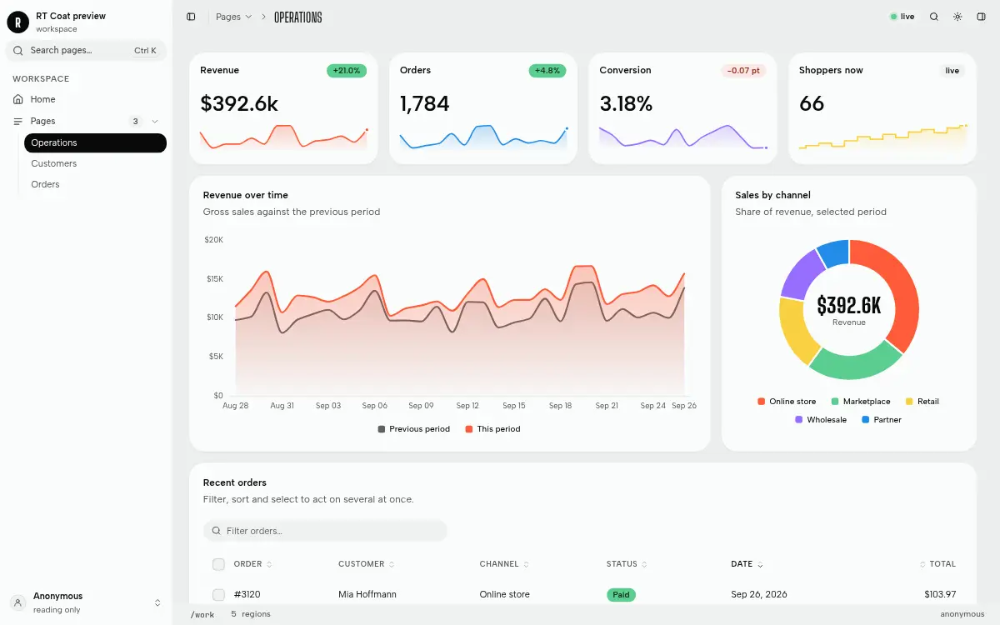
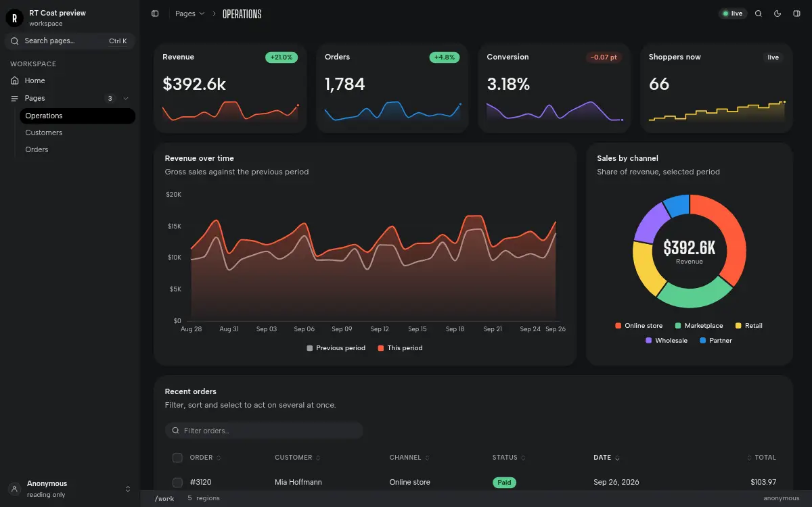

# Canvas (`canvas`)

A Page Shell for RT Station, version 0.1.5.

**Canvas** is the classic RT Station Page Shell: a collapsible sidebar with the page tree and an account menu, a
title bar with the breadcrumbs and the stream lamp, the tray (`#main`) and an inspector column. It has all 7 Patch
Regions of the standard Stage. It wears any theme and was designed in `bento`.





The screenshots show a preview Workspace with `ribbon-sheet`'s sample Pages; canvas ships no sample Pages.

## What it has

| Region | Where it lives |
|---|---|
| `header` | above the main region, under the title bar |
| `rail` | icons beside the navigation |
| `navigation` | the Workspace's links, in the sidebar |
| `main` | the work of the Page (the tray) |
| `aside` | the inspector column: notes an agent adds beside the work (capped) |
| `layer` | toasts and notices for one browser (personal) |
| `footer` | the status line |

## What it needs

- **RT Station** 0.20.1 or later (the public `rt`; v0.20.1 is current and the release this listing is tested
  on). Earlier releases lack fonts and tokens it uses. The manifest's `datastart` range says so.
- **The RT Coat library, which the `rt` binary carries.** RT Coat is the UI library inside the `rt` binary;
  RT Station serves it at `/static/ui/` to every Workspace. This listing contains none of the library. It holds
  the shell's own files only, and its page template links the library from the binary at run time:
  `design/index.css`, the `rt-*` elements, `plugins/cmd.js`, `plugins/feed.js` and `plugins/theme.js`. A theme
  from this repository, or one of the themes `rt` carries, supplies the colours.

`rt` v0.20.1 already carries Canvas 0.1.0. This version reads the theme menu and the palette's theme list from
the Workspace's `theme.css`, so every installed theme appears in them, including the ones from this repository.

## Install

### On rt v0.20.1 (by hand)

v0.20.1 has no command that installs an outside shell, so you copy the files yourself. Get this repository (clone it,
or download the tag `canvas--v0.1.5` from its releases), stop the Workspace, then run these from the Workspace's root folder:

```sh
L=path/to/official-artyficial/shells/canvas
cp "$L/web/index.html" .ds/web/index.html             # as the Workspace's default shell
mkdir -p .ds/web/plugins && cp "$L"/web/plugins/* .ds/web/plugins/
```

To wear it on some Pages only, copy `web/index.html` to `.ds/web/shells/canvas.html` instead and run
`rt page set <slug> --shell canvas` for each Page. Start the Workspace again.

### On the next rt release (with `rt package`)

`rt package` is on RT Station's main line but has not been released yet. Once it is, run this from the Workspace's
root folder, with the Workspace stopped:

```sh
rt package pack path/to/official-artyficial/shells/canvas        # writes canvas.tar.gz and prints its two digests
rt package preview --archive canvas.tar.gz --workspace . --allow-unsigned
rt package install --archive canvas.tar.gz --sha256 <package_sha256> --digest <manifest_sha256> --kind shell --allow-unsigned
```

The installer checks this package's `datastart` range against the `rt` version and each file against `manifest.json`.
A package with the same name as one that `rt` carries takes its place.

## Files

| Path | What it is | Installs as |
|---|---|---|
| `web/index.html` | the page template (the manifest's `entry`) | `web/index.html`, or `web/shells/canvas.html` |
| `web/plugins/*` | the browser plugins (`index.js` loads each one when a Page uses its attribute) | `web/plugins/*` |
| `manifest.json` | the UI package manifest: regions, plugins, `defaultTheme`, file digests | not installed |
| `.artyficial/` | the marketplace listing and its screenshots | not installed |

## Licence

MIT, see `LICENSE`, for every file in this folder except `web/plugins/on-keys.js`. That file is third-party code:
npm `@mbolli/datastar-attribute-on-keys` 1.2.0, © 2025 Michael Bolli at zwei und eins gmbh and
datastar-attribute-on-keys contributors, under MIT. Its copyright line and permission notice are in
`web/plugins/LICENSE-on-keys.txt`. The provenance of every browser plugin is in `web/plugins/LICENSES.md`. `phi.js`, which that table lists, is not part of this listing: `rt init` already writes it into every
Workspace's `plugins/` folder, and `plugins/index.js` loads it from there only when a Page uses one of its attributes.
ApexCharts (MIT) and highlight.js (BSD-3-Clause), which two plugins load, are served by the `rt` binary with their
licences and are not shipped here. The shell names no web font of its own: the theme supplies the faces.
