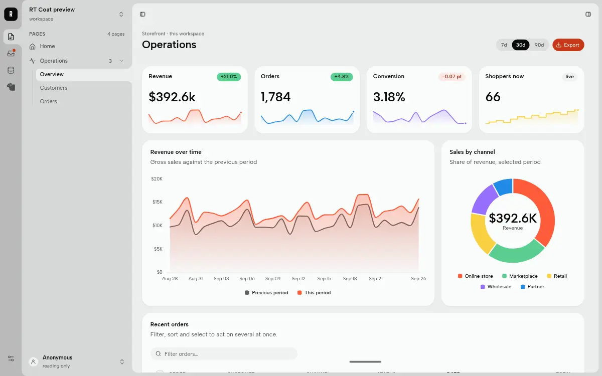
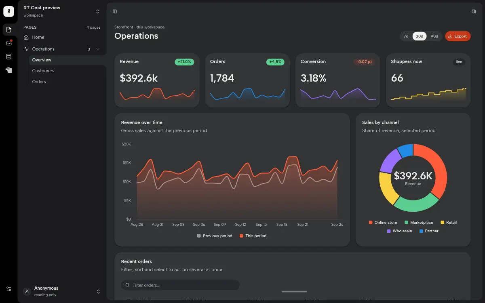

# Ribbon & Sheet Showcase (`ribbon-deck`)

A Page Shell for RT Station, version 0.3.5.

**Ribbon & Sheet Showcase** is the full Ribbon & Sheet: a ribbon, a sidebar and a sheet in one tonal ramp, the AI pill
with its palette, pins that fly into a fused inspector, demo Inbox and Data panels, and an Agents sidebar. All 9 of
its Patch Regions are live. `rt` v0.20.1 uses an earlier version of it (0.3.0) as its default shell. For a new,
empty Workspace, `ribbon-sheet` is the blank version.





## What it has

| Region | Where it lives |
|---|---|
| `rail` | in the ribbon, under the sidebar icons |
| `navigation` | the Pages sidebar, under the tree |
| `header` | a tinted strip pinned under the titlebar |
| `main` | the tray in the sheet |
| `aside` | the inspector, fused to the sheet's right edge (capped) |
| `footer` | the bar, left of the pill |
| `layer` | replies and notices above the pill (personal) |
| `console` | the pill's agent console: a session picker and the conversation (personal) |
| `agents` | the body of the Agents sidebar (personal) |

**The agent slot.** The pill and the Agents sidebar can talk to an agent capability that the Workspace provides.
The shell names the herdr console Plugin (`artyficial.herdr.console`), which is a separate listing. Without that
Plugin, the shell works fully: the pill is a local demo, the Agents icon is hidden, and the `console` and `agents`
regions stay empty.

## What it needs

- **RT Station** 0.20.1 or later (the public `rt`; v0.20.1 is current and the release this listing is tested
  on). Earlier releases lack fonts and tokens it uses. The manifest's `datastart` range says so.
- **The RT Coat library, which the `rt` binary carries.** RT Coat is the UI library inside the `rt` binary;
  RT Station serves it at `/static/ui/` to every Workspace. This listing contains none of the library. It holds
  the shell's own files only, and its page template links the library from the binary at run time:
  `design/index.css`, the `rt-*` elements, `plugins/cmd.js`, `plugins/feed.js` and `plugins/theme.js`. A theme
  from this repository, or one of the themes `rt` carries, supplies the colours.

A Workspace made with `rt` v0.20.1 already has ribbon-deck 0.3.0 and a `stage.json` with all 9 regions. Copying
these files moves it to this version. `web/index.html` and `web/pages/_shell.css` always move together.

## Install

### On rt v0.20.1 (by hand)

v0.20.1 has no command that installs an outside shell, so you copy the files yourself. Get this repository (clone it,
or download the tag `ribbon-deck--v0.3.5` from its releases), stop the Workspace, then run these from the Workspace's root folder:

```sh
L=path/to/official-artyficial/shells/ribbon-deck
cp "$L/web/index.html" .ds/web/index.html             # as the Workspace's default shell
mkdir -p .ds/web/plugins && cp "$L"/web/plugins/* .ds/web/plugins/
cp "$L/web/pages/_shell.css" .ds/web/pages/_shell.css
```

Start the Workspace again.

To wear it on some Pages only, copy `web/index.html` to `.ds/web/shells/ribbon-deck.html` and run
`rt page set <slug> --shell ribbon-deck` for each Page. The stylesheet and the plugins are shared, so the other two
lines above still replace the stylesheet, `deck.js` and `pill.js` of the Workspace's default ribbon-deck 0.3.0. Because
`web/index.html` and `web/pages/_shell.css` move together, copy `web/index.html` over `.ds/web/index.html` as well
whenever the default shell is ribbon-deck.

### On the next rt release (with `rt package`)

`rt package` is on RT Station's main line but has not been released yet. Once it is, run this from the Workspace's
root folder, with the Workspace stopped:

```sh
rt package pack path/to/official-artyficial/shells/ribbon-deck        # writes ribbon-deck.tar.gz and prints its two digests
rt package preview --archive ribbon-deck.tar.gz --workspace . --allow-unsigned
rt package install --archive ribbon-deck.tar.gz --sha256 <package_sha256> --digest <manifest_sha256> --kind shell --allow-unsigned
```

The installer checks this package's `datastart` range against the `rt` version and each file against `manifest.json`.
A package with the same name as one that `rt` carries takes its place.

## Files

| Path | What it is | Installs as |
|---|---|---|
| `web/index.html` | the page template (the manifest's `entry`) | `web/index.html`, or `web/shells/ribbon-deck.html` |
| `web/pages/_shell.css` | every shell style, `@layer shell` | `web/pages/_shell.css` |
| `web/plugins/*` | the browser plugins; `deck.js` (motion) and `pill.js`, `pill.css` (the pill) are the shell's own | `web/plugins/*` |
| `pages/`, `web/pages/home.css`, `web/pages/work.css` | sample Pages (`home`, `work` and two sub-pages) and their sheets; see `pages/README.md` | not installed |
| `manifest.json` | the UI package manifest: 9 regions, plugins, `defaultTheme`, file digests | not installed |
| `.artyficial/` | the marketplace listing and its screenshots | not installed |

## Licence

MIT, see `LICENSE`, for every file in this folder except `web/plugins/on-keys.js`. That file is third-party code:
npm `@mbolli/datastar-attribute-on-keys` 1.2.0, © 2025 Michael Bolli at zwei und eins gmbh and
datastar-attribute-on-keys contributors, under MIT. Its copyright line and permission notice are in
`web/plugins/LICENSE-on-keys.txt`. The provenance of every browser plugin is in `web/plugins/LICENSES.md`. `phi.js`, which that table lists, is not part of this listing: `rt init` already writes it into every
Workspace's `plugins/` folder, and `plugins/index.js` loads it from there only when a Page uses one of its attributes.
ApexCharts (MIT) and highlight.js (BSD-3-Clause), which two plugins load, are served by the `rt` binary with their
licences and are not shipped here. The Agents icon in the ribbon is a generic glyph drawn for this shell.

The theme menu draws its Folio and Harbor entries in those themes' own faces, so the shell names these three. The `rt` binary serves each face with its licence text, so this
listing ships no font files.

| Face | Licence | Licence text in the binary |
|---|---|---|
| JetBrains Mono | SIL Open Font License 1.1 | `/static/ui/fonts/OFL-jetbrains-mono.txt` |
| Libron | SIL Open Font License 1.1 | `/static/ui/fonts/OFL-libron.txt` |
| Literata | SIL Open Font License 1.1 | `/static/ui/fonts/OFL-literata.txt` |
