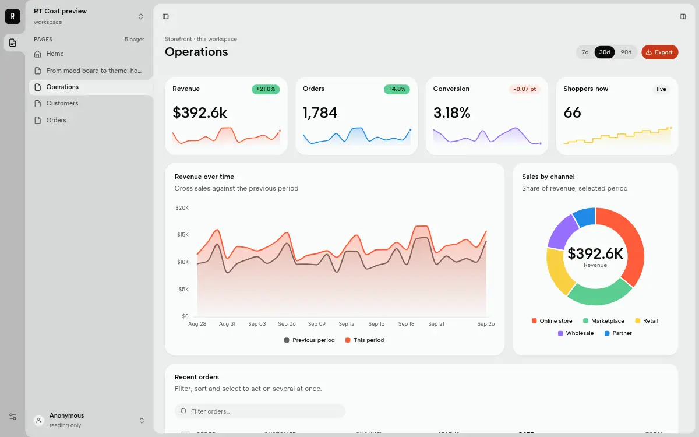
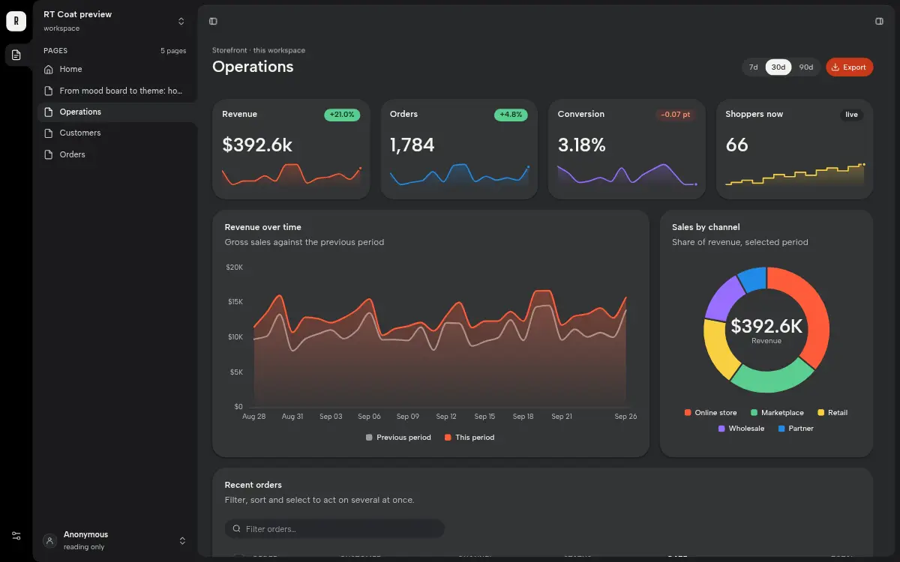

# Ribbon & Sheet (`ribbon-sheet`)

A Page Shell for RT Station, version 0.1.6.

**Ribbon & Sheet** is the blank default shell for a new Workspace: a ribbon, a sidebar and a sheet in one tonal ramp
(the ribbon darkest, the sheet lightest), with fused tabs that join each surface to the next. It also has a Ctrl/⌘ K
palette and a Details column on the right. It holds only what works in a Workspace with no Pages yet. The showcase
version, with the AI pill and the demo panels, is `ribbon-deck`.





## What it has

| Part | What it does |
|---|---|
| Ribbon | the Workspace mark and its menu, **Pages** (Alt+1), the `rail` region, **Settings** (Alt+2) |
| Pages panel | every Page, Home first; the Admin group for a superuser; the `navigation` region |
| Settings panel | Light, Dark or System; the installed themes; the account; the keys |
| Sheet | the titlebar (fold the sidebar, open Details), the `header` region, the title line, `#main`, the bar with the `footer` region |
| Details | the right column: shows what is patched into `aside`; opens while `aside` holds something, or with Ctrl/⌘ . |
| Palette | Ctrl/⌘ K: every Page, then the shell's actions (fold, mode, theme, copy the URL, the admin console) |
| `layer` | notices for one browser, centred above the bar; swipe one right to dismiss |

The theme list is read from the Workspace's `theme.css`, so a theme installed from this repository appears in
Settings and in the palette without any edit. Themes that set `--desk-lift` and `--sheet-lift` (such as `noir`) get
their own night ramp in this shell.

It has 7 Patch Regions, each with the same element, fill and Accept Rule as in `ribbon-deck`, so a Page keeps its
content when it moves between the two: `header`, `rail`, `navigation`, `main`, `aside` (capped), `layer` (personal),
`footer`.

## What it needs

- **RT Station** 0.20.1 or later (the public `rt`; v0.20.1 is current and the release this listing is tested
  on). Earlier releases lack fonts and tokens it uses. The manifest's `datastart` range says so.
- **The RT Coat library, which the `rt` binary carries.** RT Coat is the UI library inside the `rt` binary;
  RT Station serves it at `/static/ui/` to every Workspace. This listing contains none of the library. It holds
  the shell's own files only, and its page template links the library from the binary at run time:
  `design/index.css`, the `rt-*` elements, `plugins/cmd.js`, `plugins/feed.js` and `plugins/theme.js`. A theme
  from this repository, or one of the themes `rt` carries, supplies the colours.

`rt` v0.20.1 does not carry this shell (`rt init --shell` there offers canvas and ribbon-deck), so on v0.20.1 it
installs by hand only. Its Workspace's `stage.json` already declares the 7 standard regions this shell uses.

## Install

### On rt v0.20.1 (by hand)

v0.20.1 has no command that installs an outside shell, so you copy the files yourself. Get this repository (clone it,
or download the tag `ribbon-sheet--v0.1.6` from its releases), stop the Workspace, then run these from the Workspace's root folder:

```sh
L=path/to/official-artyficial/shells/ribbon-sheet
cp "$L/web/index.html" .ds/web/index.html             # as the Workspace's default shell
mkdir -p .ds/web/plugins && cp "$L"/web/plugins/* .ds/web/plugins/
mkdir -p .ds/web/ribbon-sheet && cp "$L/web/ribbon-sheet/shell.css" .ds/web/ribbon-sheet/
```

To wear it on some Pages only, copy `web/index.html` to `.ds/web/shells/ribbon-sheet.html` instead and run
`rt page set <slug> --shell ribbon-sheet` for each Page. Start the Workspace again.

### On the next rt release (with `rt package`)

`rt package` is on RT Station's main line but has not been released yet. Once it is, run this from the Workspace's
root folder, with the Workspace stopped:

```sh
rt package pack path/to/official-artyficial/shells/ribbon-sheet        # writes ribbon-sheet.tar.gz and prints its two digests
rt package preview --archive ribbon-sheet.tar.gz --workspace . --allow-unsigned
rt package install --archive ribbon-sheet.tar.gz --sha256 <package_sha256> --digest <manifest_sha256> --kind shell --allow-unsigned
```

The installer checks this package's `datastart` range against the `rt` version and each file against `manifest.json`.
A package with the same name as one that `rt` carries takes its place.

## Files

| Path | What it is | Installs as |
|---|---|---|
| `web/index.html` | the page template (the manifest's `entry`) | `web/index.html`, or `web/shells/ribbon-sheet.html` |
| `web/ribbon-sheet/shell.css` | every shell style, `@layer shell` | `web/ribbon-sheet/shell.css` (served at `/app/ribbon-sheet/shell.css`) |
| `web/plugins/*` | the browser plugins; `deck.js` runs the shell's motion | `web/plugins/*` |
| `pages/`, `web/pages/` | sample Pages (`home`, `work` and two sub-pages, `read`) and their sheets; see `pages/README.md` | not installed |
| `manifest.json` | the UI package manifest: regions, plugins, `defaultTheme`, file digests | not installed |
| `.artyficial/` | the marketplace listing and its screenshots | not installed |

## Licence

MIT, see `LICENSE`, for every file in this folder except `web/plugins/on-keys.js`. That file is third-party code:
npm `@mbolli/datastar-attribute-on-keys` 1.2.0, © 2025 Michael Bolli at zwei und eins gmbh and
datastar-attribute-on-keys contributors, under MIT. Its copyright line and permission notice are in
`web/plugins/LICENSE-on-keys.txt`. The provenance of every browser plugin is in `web/plugins/LICENSES.md`. `phi.js`, which that table lists, is not part of this listing: `rt init` already writes it into every
Workspace's `plugins/` folder, and `plugins/index.js` loads it from there only when a Page uses one of its attributes.
ApexCharts (MIT) and highlight.js (BSD-3-Clause), which two plugins load, are served by the `rt` binary with their
licences and are not shipped here.

The theme menu draws its Folio and Harbor entries in those themes' own faces, so the shell names these two. The `rt` binary serves each face with its licence text, so this
listing ships no font files.

| Face | Licence | Licence text in the binary |
|---|---|---|
| JetBrains Mono | SIL Open Font License 1.1 | `/static/ui/fonts/OFL-jetbrains-mono.txt` |
| Libron | SIL Open Font License 1.1 | `/static/ui/fonts/OFL-libron.txt` |
