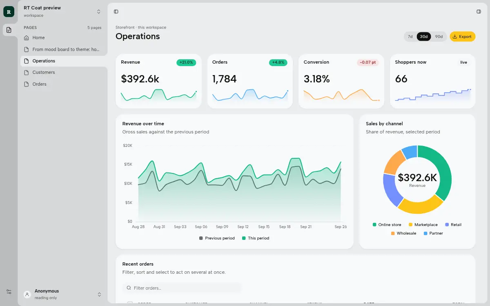
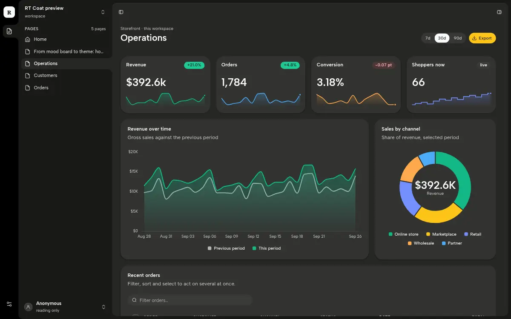

# Ledger (`ledger`)

A theme for RT Station, version 1.0.4.

Executive and finance: warm stone paper, a deep evergreen emphasis surface, gold as the one decisive action, indigo as the quiet mark, and serif figures.





Any shell can wear it. It sets the roles of the RT Coat token contract (colours, surfaces, font roles), in a day
block and a night block, and nothing else: no component rules and no font files.

`rt` v0.20.1 already carries Ledger 1.0.1.

## What it needs

- **RT Station** 0.20.1 or later (the public `rt`; v0.20.1 is current and the release this listing is tested
  on). Earlier releases lack fonts and tokens it uses.
- **The RT Coat library, which the `rt` binary carries.** RT Coat is the UI library RT Station serves at
  `/static/ui/`. The theme's roles are made of the library's colour primitives (Open Props), and its faces are the
  library's web fonts. This listing contains none of the library, only the theme's own CSS.

## Faces

The theme names these faces. The `rt` binary serves each one with its licence text, so this listing ships no font
files.

| Face | Licence | Licence text in the binary |
|---|---|---|
| Albert Sans | SIL Open Font License 1.1 | `/static/ui/fonts/OFL-albert-sans.txt` |
| JetBrains Mono | SIL Open Font License 1.1 | `/static/ui/fonts/OFL-jetbrains-mono.txt` |
| Literata | SIL Open Font License 1.1 | `/static/ui/fonts/OFL-literata.txt` |

## Install

### On rt v0.20.1 (by hand)

A Workspace's `theme.css` is the themes' shared head, then the default theme, then every other installed theme.
Each theme's block starts with a comment line that ends `build from <name>.src.css`, and the shells read that
line to list the themes. Get this repository (clone it, or download the tag `ledger--v1.0.4`), then run this from the
Workspace's root folder:

```sh
L=path/to/official-artyficial/themes/ledger
printf '\n' >> .ds/web/theme.css && cat "$L/ledger.css" >> .ds/web/theme.css
```

You can then choose it with `?theme=ledger`. It appears in the shell's theme list only with a shell that reads
the list from `theme.css`: this repository's `canvas` (0.1.5) or `ribbon-sheet` (0.1.6). The shells `rt` v0.20.1
carries (ribbon-deck 0.3.0, canvas 0.1.0), and this repository's `ribbon-deck` 0.3.5, keep a fixed theme list. If the Workspace's
`theme.css` already has a `ledger` block, from an older version, replace that block (from its header line to the
next theme's header line) with `ledger.css` instead of adding a second one. To make Ledger the default, replace the
first block (the unscoped one, right after the head) with `ledger.default.css`, and add the old default's scoped
file in its place among the others.

### On the next rt release (with `rt package`)

`rt package` is on RT Station's main line but has not been released yet. Once it is, run this from the Workspace's
root folder, with the Workspace stopped:

```sh
rt package pack path/to/official-artyficial/themes/ledger        # writes ledger.tar.gz and prints its two digests
rt package preview --archive ledger.tar.gz --workspace . --allow-unsigned
rt package install --archive ledger.tar.gz --sha256 <package_sha256> --digest <manifest_sha256> --kind theme --allow-unsigned
```

The installer checks this package's `datastart` range against the `rt` version and each file against `manifest.json`.
A package with the same name as one that `rt` carries takes its place.

## Files

| Path | What it is |
|---|---|
| `ledger.src.css` | the source: a `/*DAY*/ body {` block and a `/*NIGHT*/ body.theme-dark {` block |
| `ledger.css` | generated from the source, scoped to `[data-theme="ledger"]`: the manifest's `entry` |
| `ledger.default.css` | generated from the source, unscoped: for a Workspace whose default theme is Ledger |
| `manifest.json` | the UI package manifest: `modes`, `faces`, file digests |
| `.artyficial/` | the marketplace listing and its screenshots |

The generator that writes `ledger.css` and `ledger.default.css` from `ledger.src.css` is RT Coat's theme build, which
is not public. To change the theme, edit `ledger.src.css` and make the same change in both generated files by hand,
or open an issue and the maintainers regenerate them. Keep each generated file's first comment line, which ends
`build from ledger.src.css`: the shells match on it.

## Licence

MIT, see `LICENSE`. The faces above are not part of this listing; each is under the SIL Open Font License 1.1, as
the table says.
